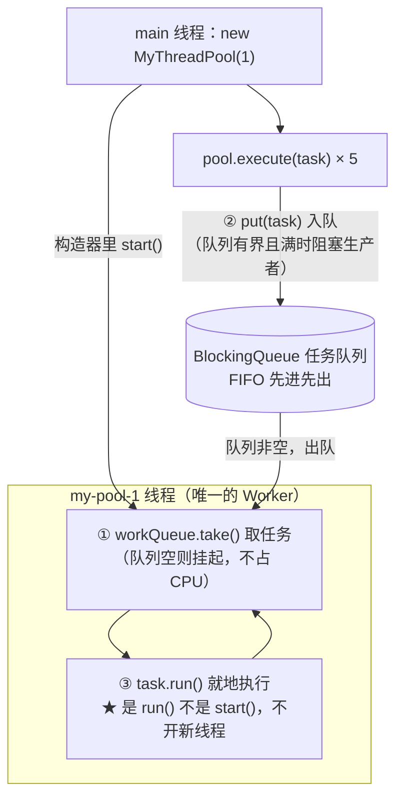
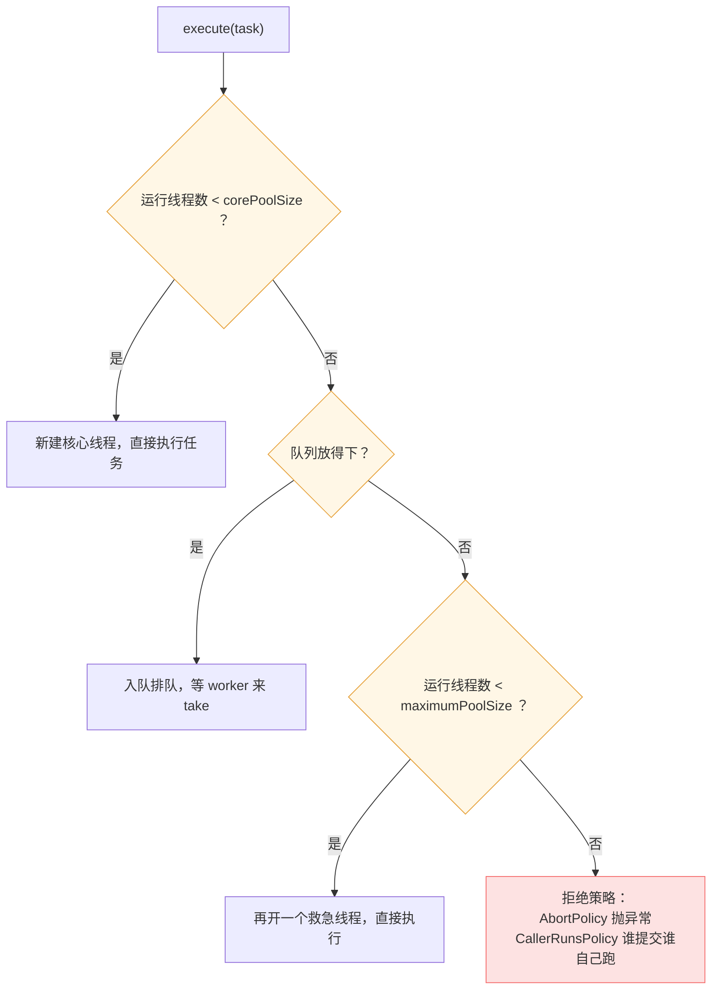

# mythreadpool 流程图

> M1（单线程池）已实现；M2–M5 按里程碑推进。对应代码：`mythreadpool/src/main/java/mythreadpool/MyThreadPool.java`

## 图 1 · 当前实现：生产者—消费者模型（M1）



**两个阻塞点，整个模型就通了：**

| 阻塞点 | 谁被卡住 | 什么时候 | 未来演进 |
|---|---|---|---|
| `put()` | main（生产者） | 队列有界且满 | M3 升级为拒绝策略 |
| `take()` | my-pool-1（消费者） | 队列为空 | M4 配合 `running` 标志自然退出 |

代码位置：`start()` L40 · `take()` L49 · `run()` L50 · `execute()/put()` L64–67

<details>
<summary>ASCII 备用版（点开查看）</summary>

```
  main 线程（生产者）                            my-pool-1 线程（唯一的 Worker）

  new MyThreadPool(1) ────── start() ──────▶  workerLoop() 进入 while (true)
        │                                              │
        │                                              ▼
  pool.execute(task)                          ①  workQueue.take()  ◀───┐
        │                                              │              │
        │ ② put(task) 入队                              │ 队列空？       │
        ▼                                              ├─ 是 → 挂起等待 ┘
  ┌──────────────────────────┐                         │
  │  BlockingQueue 任务队列    │◀──── 否，取出任务 ───────┘
  │  [t1] [t2] [t3] ...      │
  └──────────────────────────┘                         │
        （FIFO，先进先出）                               ▼
                                              ③  task.run() 就地执行
                                                 ★ run() 不是 start()：
                                                   任务跑在 my-pool-1 上
                                                        │
                                                        └──▶ 回到 ① 取下一个
```

</details>

## 图 2 · M3 目标：`execute()` 三段判断（对齐 JDK `ThreadPoolExecutor`）



对照阅读：JDK `ThreadPoolExecutor.execute()` 源码就是这三个 if；Tomcat `TaskQueue` 是"先开线程到 max 再入队"的反向改造。

## 里程碑速查

| 里程碑 | 内容 | 改动位置 |
|---|---|---|
| ✅ M1 | 队列 + 1 个常驻 Worker（本图 1） | 构造器 L38–43、`workerLoop()` L46、`execute()` L64 |
| M2 | core 个 worker + 线程命名 + `run()` 加 try-catch 保命 | 构造器 TODO(M2)、`workerLoop()` |
| M3 | core/max/有界队列/拒绝策略，`execute()` 三段判断（本图 2） | `execute()` 重写 |
| M4 | `running` + `shutdown()` / `shutdownNow()`，进程能正常结束 | `shutdown*()` 两个 TODO |
| M5 | TaskBus 发布/守恒断言（Kafka offset 语义） | `TaskBus.java` 两个 TODO |
